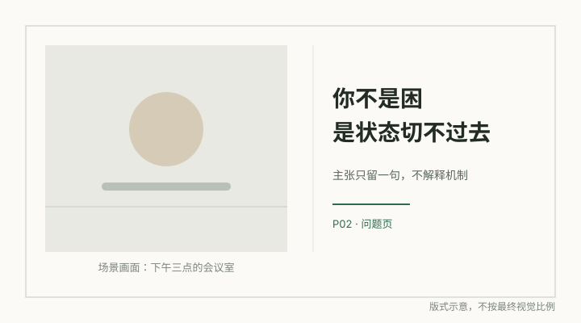

# 朗标笔试案 · 逐页文案

## 开场

### P01 封面：把状态调回来

#### 正文<!-- b:61138b -->
用一支 150ml 的植物节律液，把下午三点和睡前那一刻的状态调回来。<!-- b:718ded -->

#### 口播<!-- b:51e0c2 -->
下午三点，你不是困，是状态切不过去。<!-- b:c65ffe -->

#### 制作<!-- b:f6d69c -->
- 画面：一只手把 150ml 小瓶放回桌面，背景是会议室落地窗。<!-- b:01810e -->
- 字：主标题不超过 12 字，副标题只留价格。<!-- b:9f195f -->

#### Sources<!-- b:a58025 -->
- 主线页「一句话主线」（storyline.md）。<!-- b:607e26 -->

### P02 问题：你缺的不是咖啡因

#### 正文<!-- b:455902 -->
咖啡因解决的是「还能撑多久」，我们解决的是「什么时候切回来」。<!-- b:5a4b45 -->

#### 口播<!-- b:549067 -->
再撑一小时，还是现在就切回来？这是两个问题。<!-- b:583f84 -->

#### 制作<!-- b:ed9a36 -->

<!-- b:c6e384 -->
- 左半屏给真实场景，右半屏只放一句主张。<!-- b:14519e -->

#### Sources<!-- b:501d0c -->
- 访谈原话：「下午三点不是困，是脑子切不过去。」<!-- b:b5a916 -->

### P03 机会：150ml 的状态账户

#### 正文<!-- b:46cc17 -->
150ml 不是小包装，是把「一次有效」做成可计量的单位。<!-- b:c8a025 -->

#### 口播<!-- b:d89254 -->
15 元买的不是 150 毫升，是一次确定的状态切换。<!-- b:328b9a -->

#### 制作<!-- b:de54e3 -->
| 元素 | 规格 | 说明 |
|---|---|---|
| 瓶身 | 150ml | 一手可握，放在键盘旁不占位 |
| 价格 | 15 元 | 与一次咖啡同档 |
| 主色 | 深绿 | 植物感，不做成药感 |
<!-- b:288152 -->

#### Sources<!-- b:885c1b -->
- 竞品 SKU 盘点（2026-11-18）。<!-- b:28d729 -->

## 方案

### P04 产品：一支的可预期

#### 正文<!-- b:e7624b -->
可预期来自两件事：剂量固定，体感在 20 分钟内出现。<!-- b:33d0ae -->

#### 口播<!-- b:574171 -->
一支就是一次，不用量，也不用等。<!-- b:7844b0 -->

#### 制作<!-- b:601725 -->
```text
p04/
├─ copy.md
├─ p04.svg
└─ assets/rhythm-curve.svg
```
<!-- b:36c9df -->
- 图与文案分文件存，改图不动文案。<!-- b:10c618 -->

#### Sources<!-- b:f94304 -->
- 内部试用记录 04：8 人中 7 人在 20 分钟内报告体感变化。<!-- b:deb1f1 -->

### P05 证据：成分与体感

#### 正文<!-- b:332da5 -->
成分只讲三种，多一种就多一个被质疑的理由。<!-- b:28e04d -->

#### 口播<!-- b:11c291 -->
不讲「科学配方」，讲这三种成分各自做了什么。<!-- b:c4b911 -->

#### 制作<!-- b:5cd800 -->
- 三条证据按「研究—体感—复购」排序，每条不超过 18 字。<!-- b:a1979d -->

> 证据屏的目标不是说服，是让人愿意试第一支。<!-- b:01bf22 -->

#### Sources<!-- b:bd2b4d -->
- 成分研究清单见项目资料库 `research/ingredients.md`。<!-- b:d8d8c1 -->
- 试用记录 04（2026-11-16）。<!-- b:83d549 -->

### P06 落地：两个时点、一条动线

#### 正文<!-- b:fdb6c4 -->
首轮只打下午与睡前，同一句主张换两套场景画面。<!-- b:424888 -->

#### 口播<!-- b:ddb0b8 -->
下午在办公室，睡前在床头，两个地方看到同一句话。<!-- b:5b789e -->

#### 制作<!-- b:a6bfff -->
| 时点 | 渠道 | 素材 |
|---|---|---|
| 15:00 | 写字楼电梯 | 15 秒竖版 |
| 22:30 | 小红书信息流 | 图文 6 张 |
<!-- b:277fb6 -->
- 两个时点共用同一句主张，只换场景画面。<!-- b:eb97aa -->

#### Sources<!-- b:c9dab1 -->
- 媒介预算草案 v1（内部记录 06）。<!-- b:de2f60 -->
