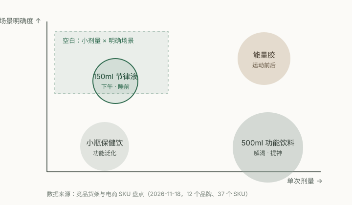

# 一、判断

## 品类机会不在「解渴」，在「调节状态」

主张：用 150ml 浓缩形态进入「状态调节」货架，不在 500ml 解渴池里比价。<!-- b:7b057d -->

- 500ml 功能饮料的承诺是「补充」，价格锚定 5–8 元，进入的是即时解渴账户。<!-- b:deb3fc -->
- 目标人群在下午三点与睡前两个时点要的是「切换状态」，愿意为确定性付 15 元。<!-- b:319d52 -->
- 剂量做小、浓度做高，才有资格谈「一支就有效」。<!-- b:8e73b6 -->

> 2026-11 消费者访谈，8 人，上海与杭州（内部记录 03）。<!-- b:21dcae -->

> 便利店冷柜价格带观察：500ml 功能饮料 5–8 元。<!-- b:e7e701 -->

## 人群不是「熬夜党」，是「需要准时切换的人」

主张：把人群从身份标签换成时刻表，产品才有明确的购买时机。<!-- b:292f6c -->

> 我们不是在卖提神，是在卖「把状态按时调回来」。<!-- b:0f4266 -->

- 熬夜党是事后解释，不是购买场景；人不会为了「我是熬夜党」在下午三点结账。<!-- b:36e7b2 -->
- 两个高频时刻：15:00–16:00 的会议后低谷，22:30–23:30 的睡前收尾。<!-- b:c2ae39 -->

> 访谈原话摘录：「下午三点不是困，是脑子切不过去。」<!-- b:910ad9 -->

> 电商评论抽样 60 条，睡前场景提及 21 条。<!-- b:08f825 -->

## 竞争空白在「剂量—场景」的交叉处

主张：大瓶在拼容量，小瓶在拼功能，没人把「一次一支」和「两个时刻」绑在一起。<!-- b:2534cb -->

<!-- b:e3d281 -->
- 横轴是单次剂量，纵轴是场景明确度；现有产品挤在左下与右上。<!-- b:d5fc89 -->
- 150ml、15 元、两个时刻，落在左上角的空白格。<!-- b:3669fa -->

> 竞品货架与电商 SKU 盘点（2026-11-18，12 个品牌、37 个 SKU）。<!-- b:727685 -->

# 二、主线

## 一句话主线：一支 150ml，把状态调回来

主张：所有页面只服务这一句，不再增加第二主张。<!-- b:36a372 -->

- 产品名、包装、口播的第一句都从这句话长出来。<!-- b:7dbf71 -->
- 「调回来」是结果承诺，「一支 150ml」是形式承诺，两者缺一不可。<!-- b:9c38b4 -->

> 项目内部工作稿 01（2026-11-17）。<!-- b:73711c -->

## 三条支撑：成分可信、场景明确、价格自洽

主张：支撑不铺开讲，每条只留一个可验证的事实。<!-- b:27bc54 -->

- 成分可信：植物提取物有公开研究，不发明新名词。<!-- b:dc0be9 -->
- 场景明确：只讲下午与睡前，不承诺「全天候」。<!-- b:b42e9f -->
- 价格自洽：15 元对应一次明确的状态切换，不对应容量。<!-- b:f29295 -->

> 成分研究清单见项目资料库 `research/ingredients.md`。<!-- b:b838ef -->

> 价格测试：8 人中有 6 人接受 15 元，2 人认为需先试用。<!-- b:9a299b -->

## 叙事顺序：先场景，再机制，最后证据

主张：先让人认出自己的时刻，再解释为什么有效，最后才给证据。<!-- b:ecd42b -->

> 顺序错了，证据越硬越像广告。<!-- b:536ca3 -->

- 开场不给成分表，给一个下午三点的具体画面。<!-- b:778956 -->
- 机制只用一句话，证据放在第三屏之后。<!-- b:480688 -->

> 2026-11 提案复盘会记录（内部记录 05）。<!-- b:318628 -->

# 三、落地

## 首轮只打两个时点，不做全场景铺开

主张：首轮资源集中在两个时刻，用同一套素材反复打。<!-- b:0b0e20 -->

- 下午场投写字楼电梯与咖啡店桌面，睡前场投小红书与播客。<!-- b:6fe39f -->
- 不投早餐、运动、加班三个场景，避免「万能饮料」的印象。<!-- b:962126 -->

> 媒介预算草案 v1（内部记录 06）。<!-- b:9e25c5 -->

## 成功判据：复购与场景提及率

主张：首轮看两个数，不看曝光与点赞。<!-- b:05bcbc -->

- 复购：30 天内第二次购买的比例，目标 18%。<!-- b:acc3dc -->
- 场景提及：用户能主动说出「下午」或「睡前」的比例，目标 40%。<!-- b:c44d45 -->

> 项目验收口径，与客户在 2026-11-18 对齐。<!-- b:f6fe0f -->
